# HLD và LLD

Trạng thái: cập nhật 2026-11-20, khớp với main sau PR #185.
Thay bộ ảnh PNG ngày 05-06/11 trong `hld-lld/`, vốn thiếu flashcard, video, SCORM, trang học viên, OpenRouter, đồng giảng viên và hồ sơ production.
Hình viết bằng Mermaid để GitHub tự vẽ và sửa được bằng tay; script vẽ ảnh cũ đã mất.
Số đo nằm trong report (mục Results), tài liệu này chỉ mô tả thiết kế.

## 1. HLD

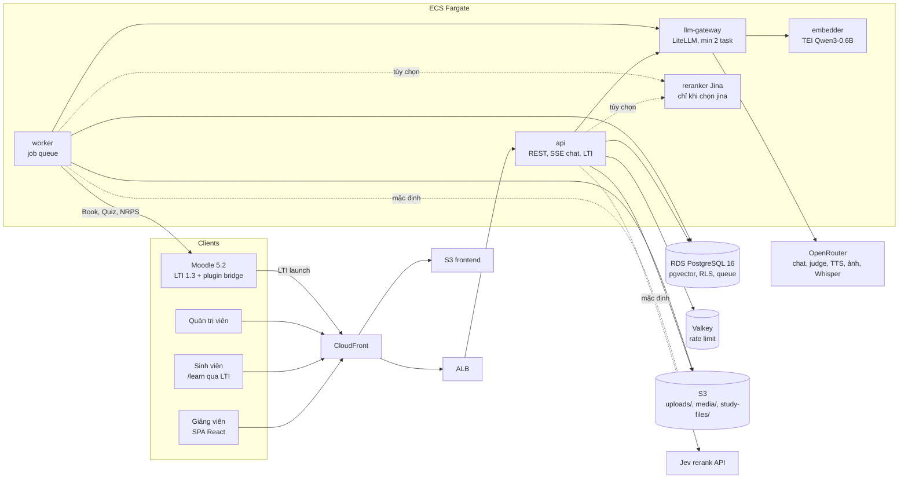

Kiểu kiến trúc: modular monolith.
Một image backend chạy thành hai service với tín hiệu scale khác nhau: `api` theo request và CPU, `worker` theo số job đang chờ (`JobsReady`).
Mọi service đều stateless: dữ liệu, vector và hàng đợi ở Postgres, file ở S3, bộ đếm rate limit ở Valkey (mất cũng không sao).
Mọi lệnh gọi model đi qua gateway, chỉ gateway giữ khóa OpenRouter; reranker là ngoại lệ, gọi thẳng từ backend.

### Hai hồ sơ triển khai

| | Demo (`terraform.tfvars`, mặc định) | Production (`infra/environments/production.tfvars`) |
| --- | --- | --- |
| Mục tiêu | Chạy khi cần đo hoặc demo, vừa $200 credit | Khoảng 30.000 người dùng, 10-20% online cùng lúc |
| api | 1-4 task | 2-12 task, 1 vCPU, 2 GB |
| worker | 1-8 task, 4 job mỗi task | 2-12 task, 1 vCPU, 3 GB, 4 job mỗi task |
| gateway | 2-4 task, scale theo CPU | 2-6 task, 1 vCPU |
| embedder | 1-2 task, 4 vCPU, 8 GB | 1-3 task |
| RDS | `db.t4g.medium`, single-AZ, backup 1 ngày | `db.m7g.large`, Multi-AZ, chống xóa, backup 14 ngày |
| Kết nối DB khi tải đầy | 349/407 | 653/897 (Terraform check chặn nếu vượt) |

Hồ sơ production chưa được apply và chưa load test; nó được `terraform test` kiểm tra trên AWS giả lập trong CI.
Quá 12 api và 12 worker, bước tiếp theo là PgBouncer ở transaction mode (`scalable-design.md`, mục 7).

## 2. LLD theo module

### 2.1 API và phân quyền

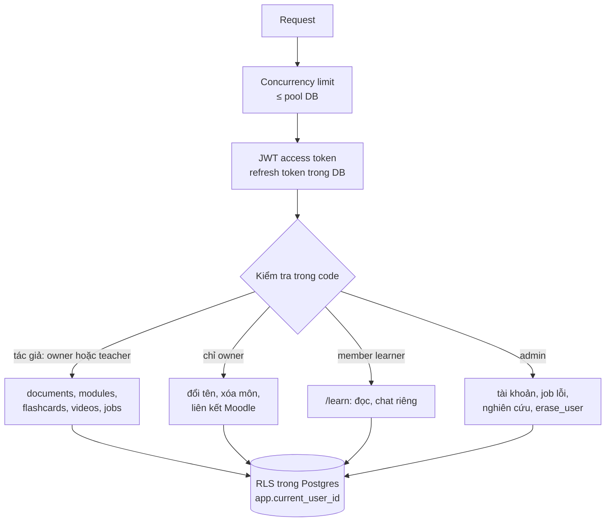

Mỗi request chạy bằng role `app_runtime`, đặt `app.current_user_id` cho phiên; RLS lọc lại ở tầng DB nên một lỗi kiểm tra trong code không lộ dữ liệu tenant khác.
`app_authored_course_ids()` (migration 0049) trả các môn mình sở hữu cộng các môn mình là `teacher`; mọi policy của documents, chunks, modules, jobs, flashcard_sets, videos dùng nó.
Không có quyền thì trả 404, không phải 403, để một id không tự xác nhận là có tồn tại; riêng đồng giảng viên chạm vào việc chỉ owner được làm thì nhận 403 có lý do.
Thao tác admin xuyên tenant đi qua hàm `SECURITY DEFINER` có kiểm tra `current_user_is_admin()`.
`erase_user` (0048) xóa email, tên, mật khẩu, liên kết Moodle, chat, membership, phiên đăng nhập và tên trong danh sách người chấm; giữ dòng user để lượt chấm còn khóa ngoại; từ chối khi người đó còn sở hữu môn học.

### 2.2 LTI 1.3 và người trong môn

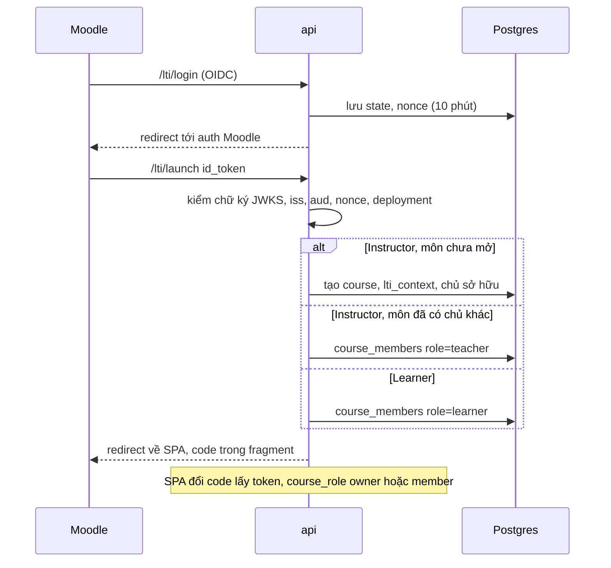

Vai trò do Moodle ký, nên sinh viên được Moodle chuyển thành instructor (trợ giảng) sẽ thành `teacher`.
Danh sách lớp đồng bộ qua NRPS trong job của worker.

### 2.3 Hàng đợi job

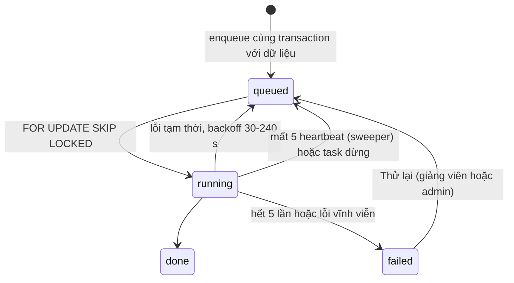

Bảy loại job: `document_pipeline`, `module_generation`, `flashcard_generation`, `video_script`, `video_images`, `video_render`, `study_judge`.
`handle_job_error` đánh dấu job và đối tượng của nó (document, set, video) thất bại trong một transaction.
Worker xin ECS scale-in protection khi đang có job; khi bị dừng, nó trả job về hàng đợi sau 100 s mà không tính một lần thử.

### 2.4 Nạp tài liệu

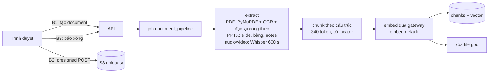

### 2.5 Truy hồi

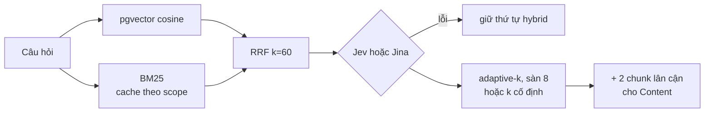

Phạm vi: module trong một tài liệu, chat trong cả môn.

### 2.6 Sinh mô-đun

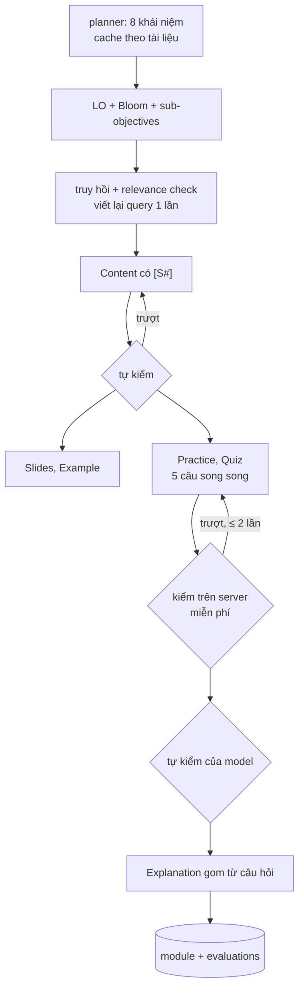

Mỗi mô-đun khoảng 14-25 lệnh gọi model.
Điều kiện no-RAG của nghiên cứu chạy cùng các bước, bỏ khối nguồn; mô-đun đối chứng không xuất bản được.
Giới hạn còn lại: job không có checkpoint giữa các bước, nên chạy lại sau khi bị dừng sẽ gọi lại model đã trả tiền.

### 2.7 Flashcard và video

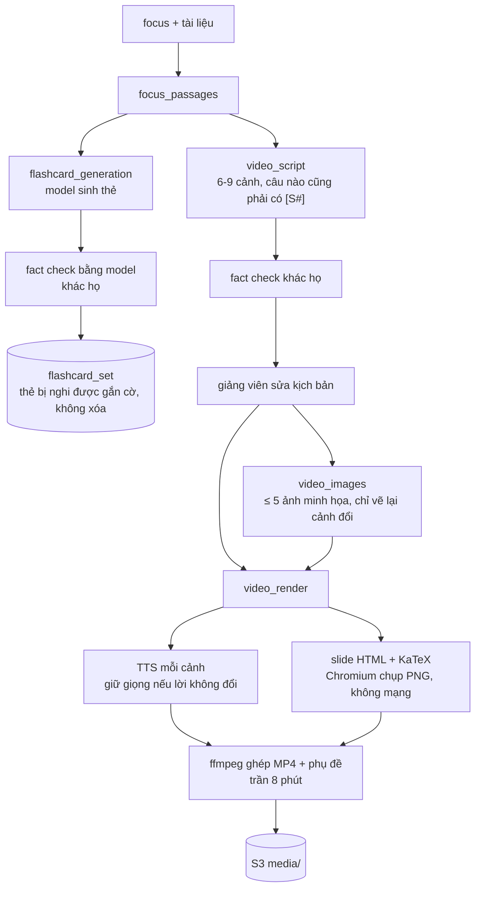

Ảnh, giọng và chữ tách nhau: model ảnh chỉ vẽ hình, chữ trên slide do hệ thống in từ kịch bản nên luôn đúng chính tả và khớp nguồn.
Ảnh và giọng đã trả tiền được giữ khi một cảnh khác lỗi; job lỗi nêu tên cảnh lỗi.
Trình duyệt hỏi lại slide đã có sẽ nhận 304 theo ETag, không render lại.

### 2.8 Chat

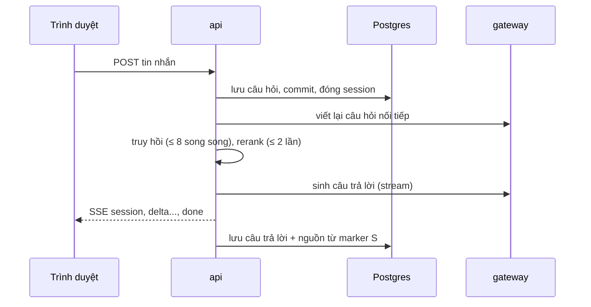

Không giữ kết nối DB khi chờ model; `chat_max_streams` trả 503 trước khi task quá tải.
Sinh viên có trần chat mỗi ngày; giảng viên không đọc chat của sinh viên.

### 2.9 Xuất bản

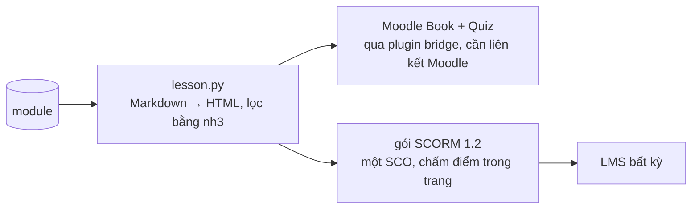

### 2.10 Nghiên cứu chấm điểm

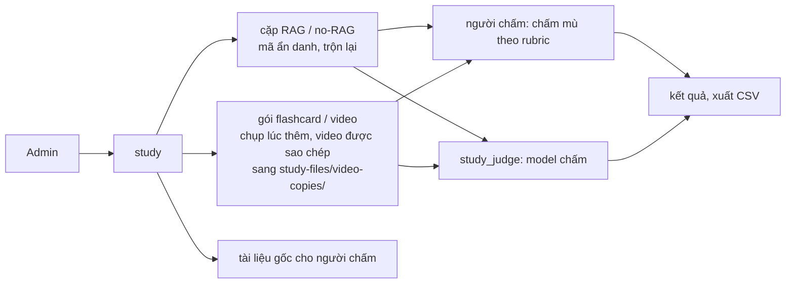

Gói là ảnh chụp tại lúc thêm, nên giảng viên sửa, dựng lại hay xóa bản gốc không đổi thứ đã được chấm.

## 3. Còn thiếu so với kiến trúc đầy đủ

- Job sinh mô-đun chưa có checkpoint giữa các bước.
- Render video dùng chung worker (1 vCPU, 3 GB) với các job khác; tách một worker render riêng khi lượng video tăng.
- Chưa có PgBouncer; cần khi vượt 12 api và 12 worker.
- Hồ sơ production chưa được apply và chưa load test.
- Chưa có giao diện nhập mô-đun mẫu do giảng viên viết (nhóm `human` đã có ở backend).
