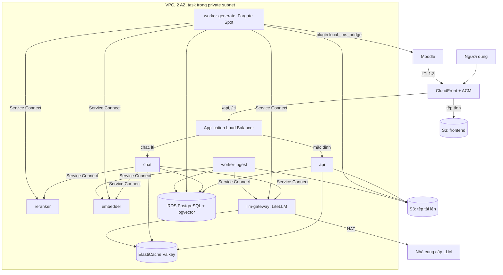
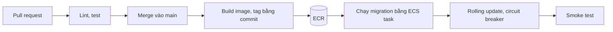
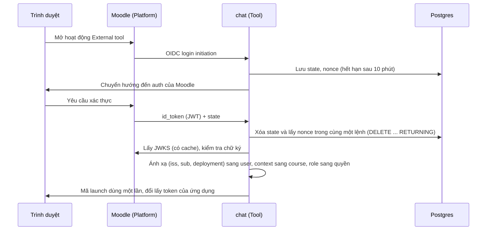

# Thiết kế kiến trúc cloud-native trên AWS

Trạng thái: bản thiết kế, chưa triển khai. Cập nhật 2026-11-05.

Tài liệu trả lời phản hồi của giảng viên hướng dẫn: triển khai cloud-native trên AWS với $200 credit, scale được, bảo trì
được, giải trình được ngân sách và lock-in. Không nhắm tới một số người dùng cụ thể; quy mô BK LMS chỉ là bối cảnh. Mục 13 đối
chiếu từng ý phản hồi với hiện trạng.

Con số được ghi rõ là **đo được**, **giá công bố** hoặc **ước tính**. Số đo đến từ một máy dùng chung với LLM giả lập, nên chúng
cho biết tỷ lệ và điểm nghẽn, chưa phải năng lực trên cloud.

## Phạm vi triển khai trong đồ án

Các mục từ 1 trở đi mô tả kiến trúc đầy đủ, dùng làm hướng phát triển. Đồ án chỉ triển khai bản tối giản dưới đây: vẫn cloud-native và
scale ngang được, nhưng một người có thể dựng, giải thích và bảo vệ từng phần.

| Phần | Kiến trúc đầy đủ | Bản đồ án | Đánh đổi |
| --- | --- | --- | --- |
| Service | 7 | 5: `api`, `worker`, `reranker`, `embedder`, `llm-gateway` | Chat dùng chung task với API, cần giới hạn riêng |
| Worker | Hai loại, có Spot | Một loại, on-demand, 1 vCPU, 3 GB (cỡ ước tính, cần đo với tài liệu lớn) | Trả tiền cho CPU dư khi chỉ sinh module |
| Mạng | Private subnet, NAT | Public subnet và security group, RDS và Valkey không mở ra Internet | Ít một lớp bảo vệ |
| Deploy | Pipeline tự động qua OIDC | CI hiện có để test, deploy bằng script, circuit breaker của ECS để quay về | Deploy thủ công |
| Terraform | Nhiều môi trường | Một thư mục, một môi trường, vẫn xóa được bằng một lệnh | Không tách môi trường |
| Giám sát | Nhiều metric, cảnh báo qua SNS | Log CloudWatch, metric độ sâu hàng đợi, AWS Budgets | Không có thông báo khi lỗi |
| Xuống cấp | Circuit breaker | Reranker lỗi thì chat dùng hybrid | Mỗi tin vẫn đợi hết lần thử |
| LTI | Launch, Deep Linking, điểm, danh sách lớp | Launch và vai trò cho giảng viên | Sinh viên chưa chat được, tránh đổi RLS |

Giữ nguyên vì là cốt lõi của yêu cầu: ECS Fargate, ALB, RDS, S3, ElastiCache, CloudFront, Service Connect, autoscale cho `api` và `worker`, chat
stream để đo TTFT, hàng đợi trên Postgres, RLS, không lưu bí mật trong code.

**Thí nghiệm rút còn bốn:** scale `api` ở 1, 2, 4 task; scale `worker` kèm `reranker` ở 2, 4, 8 worker; chịu lỗi bằng cách dừng từng loại task; một đợt nhỏ với LLM thật
để biết quota.

**Chi phí:** demo khoảng $0,90/giờ x 70 giờ = $63, đo tải khoảng $2,65/giờ x 8 giờ = $21, lưu trữ và log khoảng $12, tổng khoảng $96, hoặc $115 với 20% dự phòng sai số. Cấu
hình demo chỉ rẻ hơn khoảng 15% mỗi giờ so với kiến trúc đầy đủ vì reranker và embedder vẫn giữ nguyên. Lợi ích chính là giảm khối lượng công việc.

## 1. Tóm tắt

- **Chạy container trên ECS Fargate**, tự scale từng service theo tín hiệu riêng của nó. Dữ liệu nằm ở dịch vụ managed: RDS, S3,
  ElastiCache. Hạ tầng viết bằng Terraform, deploy qua GitHub Actions.
- **Service không giữ state**, nên thay, thêm hoặc mất một task đều không mất dữ liệu.
- **Tách theo đặc tính tải, không tách theo nghiệp vụ.** Một codebase, một image backend, chạy thành các service `api`, `chat`,
  `worker-generate`, `worker-ingest`. Không chia microservice, vì không có nhóm nào cần deploy độc lập.
- **Điểm nghẽn là reranker và quota LLM.** Thiết kế cô lập chúng và xuống cấp có kiểm soát thay vì để cả hệ thống đứng.
- **$200 đủ để dựng, đo và bảo vệ** (khoảng $132, hoặc $159 với 20% dự phòng sai số), với điều kiện chỉ bật khi dùng. Vận hành
  liên tục thì không đủ: khoảng $784/tháng, chưa tính LLM.

## 2. Nguyên tắc thiết kế

1. **Cloud-native không có nghĩa là dùng càng nhiều dịch vụ càng tốt.** Mỗi dịch vụ AWS phải trả lời được: nó thay thế việc vận
   hành nào, và nếu rời AWS thì mất gì.
2. **Quyết định dựa trên số đo.** Khi chưa đo được thì ghi là giả thuyết và có thí nghiệm kiểm chứng.
3. **Mỗi service có một tín hiệu scale và một cách xử lý quá tải.** Không có thì chưa thể gọi là scale được.
4. **Ưu tiên thay đổi đảo ngược được,** và ghi rõ dấu hiệu nào thì phải xem lại quyết định.

## 3. Yêu cầu phi chức năng

Các ngưỡng là đề xuất của thiết kế, cần giảng viên đồng ý.

| Thuộc tính | Mục tiêu |
| --- | --- |
| API đọc | p95 dưới 500 ms, lỗi dưới 0,1% |
| Chat | Token đầu tiên trong 3 s ở p95 |
| Sinh module | Không job nào thất bại vì tải. Bắt đầu trong 5 phút lúc bình thường, quá tải thì xếp hàng |
| Scale | Tăng task thì năng lực tăng, không sửa code, có số đo chứng minh |
| Chịu lỗi | Mất một task hoặc một AZ của tầng ứng dụng thì tự hồi phục, không mất job |
| Khôi phục | RPO 5 phút, RTO 1 giờ, từ backup của RDS. Mục tiêu cho vận hành thật, demo chấp nhận thấp hơn |
| Vận hành | Deploy và rollback tự động, không SSH vào máy, có cảnh báo |
| Chi phí | Toàn bộ đồ án dưới $200 credit |

## 4. Kiến trúc

| Service | Trách nhiệm | Cỡ task | Tín hiệu scale | Khi quá tải |
| --- | --- | --- | --- | --- |
| `api` | CRUD, đọc, tạo job | 1 vCPU, 2 GB | Request mỗi target | Giới hạn đồng thời, trả 503 có `Retry-After` |
| `chat` | Chat stream, LTI launch | 0,5 vCPU, 1 GB | Kết nối đang mở | Giới hạn stream, bỏ rerank |
| `worker-generate` | Sinh module, chờ LLM là chính | 0,5 vCPU, 1 GB, Spot | Job đang chờ | Job nằm trong hàng đợi |
| `worker-ingest` | Đọc PDF, OCR, nhúng, tốn CPU | 2 vCPU, 4 GB, giảm được về 0 | Job đang chờ | Job nằm trong hàng đợi |
| `reranker` | Chấm lại ứng viên | 4 vCPU, 8 GB | CPU, độ trễ | 429, client thử lại rồi dùng hybrid |
| `embedder` | Nhúng truy vấn và tài liệu | 4 vCPU, 8 GB | CPU, độ trễ | 429, client thử lại |
| `llm-gateway` | Định tuyến LLM, giữ khóa, quota | 0,5 vCPU, 1 GB | CPU | Xếp hàng theo quota |

Cỡ `worker-generate` dựa trên số đo: khoảng 230 đến 310 MB, CPU rất thấp vì chủ yếu chờ LLM. Cỡ `worker-ingest` là ước tính, cần đo
lại với tài liệu lớn.

## 5. Các quyết định chính

| Vấn đề | Chọn | Lý do | Không chọn | Xem lại khi | Lock-in |
| --- | --- | --- | --- | --- | --- |
| Chạy container | ECS Fargate | Không quản máy, tự scale, IAM theo từng task | EKS: thêm phí control plane và cả một hệ sinh thái phải vận hành. Lambda: giới hạn 15 phút, không hợp model nặng | Cần hệ sinh thái Kubernetes hoặc nhiều nhóm | Trung bình: phải viết lại task definition, image giữ nguyên |
| Database | RDS PostgreSQL + pgvector | Backup, PITR, Multi-AZ chỉ là một tham số. Giữ được RLS | Aurora: giá trị thể hiện ở tải lớn hơn. Vector DB riêng: thêm hệ thống phải đồng bộ quyền, trong khi retrieval lọc theo từng khóa | CPU cao kéo dài | Thấp: `pg_dump` |
| Hàng đợi | Giữ bảng Postgres, đẩy độ sâu lên CloudWatch | Lượng job rất nhỏ. Tạo job cùng transaction với dữ liệu nên không cần outbox. Đã có heartbeat, retry, đã test tải | SQS: cần outbox để tránh ghi lệch, trong khi trạng thái job vẫn phải ở Postgres | Vượt khoảng 100 job/s, hoặc polling thành tải đáng kể | Không có |
| Cache, bộ đếm | ElastiCache Valkey | Không phải vá và theo dõi. Rẻ hơn Redis 20% theo bảng giá, cùng giao thức | Redis tự chạy: tiết kiệm ít, thêm một task phải giữ sống | | Thấp |
| Tệp | S3: api nhận tệp rồi đẩy lên, worker tải về khi xử lý | Bền, không cần ổ dùng chung giữa api và worker. Api chặn kích thước khi đang nhận và kiểm số trang, thời lượng trước khi tạo job | EFS: đắt và phức tạp hơn, giữ kiểu dùng file không cần thiết. Presigned URL: api không phải chịu băng thông upload, nhưng phải kiểm tệp sau khi đã lên S3 | Băng thông upload qua api thành nút cổ chai, hoặc video 1 GB chạm giới hạn 60 s của CloudFront | Thấp: API tương thích MinIO |
| Frontend | S3 + CloudFront | Không tốn compute, có CDN, có HTTPS | Container Vite: chỉ hợp để phát triển | | Thấp |
| Cửa vào | CloudFront, ALB | Một tên miền cho tệp tĩnh và API, tránh CORS, có sẵn HTTPS. Định tuyến theo đường dẫn | API Gateway: giới hạn thời gian không hợp stream | | Thấp |
| Gọi nội bộ | ECS Service Connect | Tự cân bằng tải và thử lại giữa các task, không cần ALB nội bộ | ALB nội bộ: thêm phí giờ. Cloud Map DNS: phụ thuộc cache DNS | | Thấp |
| Reranker, embedder | Tự host TEI trên Fargate | Giữ nguyên model và vector đã đánh giá | Dịch vụ AWS: phải nhúng lại, đánh giá lại, và bó buộc | Chi phí CPU quá cao thì thử GPU | Không có |
| Gateway LLM | LiteLLM | Đổi nhà cung cấp không sửa backend, fallback đã cấu hình | Bedrock: bó buộc model vào AWS, cần đánh giá lại | | Không có |
| Bí mật | SSM Parameter Store, SecureString | Miễn phí ở bậc chuẩn, đủ cho nhu cầu | Secrets Manager: tính phí theo bí mật, xoay vòng tự động chưa cần | Cần xoay vòng tự động | Thấp |
| Hạ tầng | Terraform, state ở S3 | Tạo và xóa cả môi trường bằng một lệnh, đó là cách giữ ngân sách | Click tay: không lặp lại được. CDK, CloudFormation: bó vào AWS | | Thấp |

Reranker dùng giấy phép CC-BY-NC, cần xem lại nếu dùng ngoài mục đích phi thương mại. Thay model thì phải đo lại retrieval.

**Đánh giá lock-in tổng thể.** Code chỉ phụ thuộc Postgres, giao thức Redis, API S3 và OCI image. Phần gắn với AWS nằm ở Terraform
và task definition. Rời AWS là viết lại tầng triển khai, không phải sửa logic. Đổi lại, tầng này tận dụng được dịch vụ managed mà không
phải tự vận hành.

## 6. Ba đường tải

### Đọc

`ConcurrencyLimitMiddleware` đã giữ số request đang phục vụ không vượt quá pool database. Số đo: 199, 372, 583 rps ở 1, 2, 4 container,
không lỗi, khoảng 146 rps mỗi container.

### Chat

`POST /courses/{id}/chat` hiện lưu tin nhắn rồi gọi LLM hai lần trong cùng một transaction, không stream, trên luồng của API. Mỗi tin
giữ một suất API và một kết nối database trong lúc chờ. Đây là khoảng trống lớn nhất của kiến trúc hiện tại.

Thiết kế mới:

1. Service `chat` riêng, ALB định tuyến theo đường dẫn. Chat gặp sự cố hay quá tải thì `api` không bị ảnh hưởng.
2. Handler bất đồng bộ, trả lời bằng SSE. Một task giữ được nhiều stream vì chúng chủ yếu chờ mạng. Số stream mỗi task chưa đo, xem S3.
3. Transaction ngắn: lưu tin nhắn và commit, truy xuất, gọi LLM khi không giữ kết nối, lưu câu trả lời. Đường sinh module đã làm đúng như
   vậy: khi 4 worker chạy, ba lần lấy mẫu `pg_stat_activity` không thấy kết nối nào `idle in transaction`.
4. Timeout của ALB và CloudFront phải dài hơn khoảng lặng của stream, gửi heartbeat SSE để giữ kết nối.

**Xuống cấp có kiểm soát.** Khi reranker quá tải hoặc lỗi, chat dùng kết quả hybrid, kèm circuit breaker để không đợi timeout ở mỗi tin. Hiện
`rerank_scored` báo lỗi sau 5 lần thử.

| Cấu hình, 250 câu | Recall@1 | Recall@8 | MRR@10 |
| --- | ---: | ---: | ---: |
| Hybrid + rerank | 0,856 | 0,988 | 0,918 |
| Hybrid | 0,812 | 0,988 | 0,885 |

Chat lấy 8 đoạn làm ngữ cảnh, và recall@8 không đổi. Khác biệt ở recall@1 chưa có ý nghĩa thống kê (McNemar, p = 0,126). Giới hạn: câu hỏi trong
bộ đo dễ và cùng ngôn ngữ với tài liệu, nên phải đo câu hỏi khác ngôn ngữ trước khi mở cho sinh viên.

### Sinh module và nạp tài liệu

Tách worker theo tài nguyên. Sinh module chờ LLM nên rẻ và chạy Spot được. Nạp tài liệu tốn CPU, cần task lớn hơn, và có thể giảm về 0
khi không có việc. Mỗi nhóm chỉ nhận loại job của mình.

Số đo với LLM giả lập, cùng tải: từ 79,9 lên 199,7 module/giờ ở 8 worker, không còn module lỗi. Ở 4 worker, thêm reranker thứ hai chỉ tăng 13%
(155,8 lên 175,8), trong khi rerank trung bình giảm 32%. Mỗi reranker trung bình 230% CPU nhưng vẫn chạm trần 400% lúc đỉnh, nên có thể tải dồn
cục do mọi job bắt đầu cùng lúc đang chi phối. Việc reranker scale tốt đến đâu vẫn là giả thuyết, xem S2.

Fargate Spot báo trước 2 phút khi thu hồi. Worker bắt SIGTERM, ngừng nhận job mới. Job chưa xong được heartbeat phát hiện và chạy lại, lặp lại
các lệnh gọi LLM đã xong. Cần lưu tiến độ theo từng bước để giảm chi phí này. Cấu hình chia giữa Spot và on-demand để vẫn có một task chạy khi
hết Spot.

**Quota LLM là giới hạn cứng nằm ngoài AWS.** Một module dùng khoảng 278.000 token (đo được). Thêm worker không giúp gì khi đã hết quota, nên
autoscale của worker phải có trần tính từ quota. Hạn mức theo người dùng giữ cho chi phí nằm trong tầm kiểm soát.

## 7. State

| State | Nơi lưu | Khi mất hoặc lỗi | Trạng thái |
| --- | --- | --- | --- |
| Dữ liệu nghiệp vụ, chunk, vector | RDS | PITR | Chuyển sang RDS |
| Phiên đăng nhập | JWT, refresh token trong Postgres | Không phụ thuộc task | Có sẵn |
| Job | Postgres, `FOR UPDATE SKIP LOCKED` | Heartbeat phát hiện worker chết, chạy lại | Có sẵn |
| Rate limit | Valkey | Mỗi task tự giới hạn đến khi Valkey trở lại | Có sẵn |
| Chỉ mục BM25 | Bộ nhớ task | Chỉ là cache, đối chiếu fingerprint mỗi lần tìm | Có sẵn |
| Tệp tải lên | S3 | Độ bền của S3 | **Phải chuyển từ bind mount** |
| `state`, `nonce` của LTI | Postgres, hết hạn sau 10 phút, worker dọn | Launch thất bại, không cho qua, người dùng mở lại | Có sẵn. Không dùng Valkey: khi Valkey mất, rate limit lùi về bộ nhớ từng task, còn state thì không được lùi như vậy, vì task khác sẽ không tìm thấy |
| Bộ đếm quota LLM | Valkey qua LiteLLM | Mỗi gateway tự đếm, có thể vượt | **Thêm** |

Valkey chỉ giữ thứ có thể mất, nên một node là đủ. Không cần sticky session vì task không giữ state riêng.

**Kết nối database.** Pool hiện tại cho mỗi tiến trình worker tối đa khoảng 30 kết nối, tính theo 4 job và 5 câu hỏi song song. Trần autoscale phải
đảm bảo tổng kết nối thấp hơn `max_connections` của RDS. Khi không đủ, thêm PgBouncer chế độ transaction, vốn tương thích với `SET LOCAL` của RLS. Chưa
dùng RDS Proxy vì tài liệu AWS không khẳng định `SET LOCAL` tránh được pinning trên PostgreSQL.

**Vector search.** Retrieval luôn lọc theo khóa học rồi sắp xếp chính xác, và repo chưa có chỉ mục HNSW. Với vài trăm chunk mỗi khóa, cách này nhanh (dưới 20 ms
ở p95 trên corpus nhỏ, đo được), nên chưa cần HNSW. Xem lại khi có khóa học trên 100.000 chunk.

## 8. Chịu lỗi

| Sự cố | Hành vi thiết kế | Trạng thái |
| --- | --- | --- |
| Task `api` hoặc `chat` chết | ALB bỏ qua task, ECS thay task mới. Client mở lại stream | Đã test trên máy: kill một api, job sinh module không bị ảnh hưởng. Trên AWS chưa |
| Worker chết, Spot thu hồi | Dừng bình thường: trả job về hàng đợi ngay, không tính lần thử. Chết đột ngột: sweeper trả job sau 5 phút không có heartbeat | Đã test trên máy: 8/8 job xong, không trùng; chết đột ngột hồi phục sau 4 phút. Spot chưa test |
| Reranker lỗi | Sinh module thử lại với backoff, rồi job được thử lại. Chat thử một lần rồi dùng thứ tự hybrid | Có sẵn, đã test trên máy |
| Embedder hoặc gateway lỗi, RDS khởi động lại | Job thử lại với backoff dài (30, 60, 120, 240 s), chịu được khoảng 7 phút. Chat tìm bằng BM25 khi không có embedding | Có sẵn, đã test trên máy với sự cố 60 s |
| Nhà cung cấp LLM lỗi hoặc 429 | Gateway thử lại và fallback theo cấu hình | Có sẵn |
| Valkey mất | Rate limit theo từng task; LTI không bị ảnh hưởng vì state nằm trong Postgres | Rate limit có sẵn |
| RDS lỗi | Vận hành thật: Multi-AZ tự chuyển. Demo: khôi phục từ snapshot | Một tham số Terraform |
| Một AZ mất | Tầng ứng dụng chạy trên 2 AZ. NAT một AZ là điểm yếu đã chấp nhận vì chi phí | Theo thiết kế |
| Deploy lỗi | Circuit breaker của ECS tự quay về bản trước | Cần cấu hình |
| Migration lỗi | Migration chạy trước, không đổi service nếu lỗi. Dùng mẫu expand rồi contract | Cần quy ước |

Quy tắc chung: mọi lệnh gọi mạng có timeout và retry có backoff, job phải idempotent, tách tài nguyên để lỗi ở một đường không lan sang đường khác.

## 9. Bảo mật

- **Mạng:** RDS và các task trong private subnet. Security group chỉ cho phép đúng từng cặp service. S3 chặn truy cập công khai, dùng gateway endpoint.
- **Danh tính:** IAM role riêng cho từng task, quyền tối thiểu. GitHub Actions dùng OIDC, không lưu access key lâu dài. Không SSH, debug bằng ECS Exec khi cần.
- **Bí mật:** Parameter Store, chỉ gateway đọc được khóa LLM, giữ nguyên nguyên tắc backend không thấy khóa.
- **Dữ liệu:** mã hóa khi lưu bằng KMS khóa mặc định, TLS khi truyền. RLS tiếp tục là lớp phòng thủ thứ hai. Backend dùng role `app_runtime` và `app_worker`, không dùng owner.
- **Upload:** qua api, chặn kích thước ngay khi đang nhận (tài liệu 25 MB, âm thanh 200 MB, video 1 GB), kiểm số trang và thời lượng trước khi tạo job. Tệp trên S3 tự hết hạn sau 7 ngày.
- **Dữ liệu gửi cho LLM:** tài liệu môn học đi qua nhà cung cấp bên ngoài, cần nêu trong báo cáo và điều khoản sử dụng.

## 10. CI/CD và vận hành

- **Môi trường:** Terraform một bộ module, biến khác nhau cho `demo` và `loadtest`. Hai dòng lệnh là có môi trường, xóa xong chỉ còn snapshot, ECR và S3.
- **Rollback:** tự động qua circuit breaker, hoặc deploy lại tag cũ. Image bất biến, tag theo commit.
- **Migration tách làm hai bước** khi đổi schema phá vỡ tương thích, vì bản cũ và mới chạy song song trong lúc rolling update.
- **Log:** JSON có `request_id`, `job_id`, đưa vào CloudWatch Logs, giữ 14 ngày để hạn chế chi phí.
- **Metric:** độ sâu hàng đợi, tuổi job cũ nhất, TTFT, số lần bỏ rerank, 429 của LLM, token mỗi giờ. Đẩy bằng CloudWatch Embedded Metric Format, không thêm hạ tầng.
- **Cảnh báo qua SNS:** 5xx của ALB, p95 vượt mục tiêu, job cũ nhất quá 15 phút, CPU RDS, hết chỗ lưu trữ, ngân sách.
- **Health check:** tách `/health` khỏi `/ready`. `/ready` kiểm tra kết nối database, để ALB không gửi request vào task chưa sẵn sàng.
- **Runbook:** deploy, rollback, khôi phục, xử lý job kẹt, xoay khóa. Khôi phục phải chạy thử ít nhất một lần.

Không dùng Prometheus, Grafana hay tracing phân tán ở giai đoạn này vì CloudWatch đủ cho quy mô hiện tại. Xem lại khi cần theo dõi một request qua nhiều service.

## 11. Chi phí

Giá công bố của AWS tại Singapore, on-demand, lấy ngày 2026-11-05, trừ NAT là ước tính chưa đối chiếu. Fargate $0,05056/vCPU-giờ và $0,00553/GB-giờ. Spot rẻ hơn nhưng không
tính, để ước tính an toàn.

| Thành phần | $/giờ |
| --- | ---: |
| Task 0,5 vCPU, 1 GB | 0,0308 |
| Task 1 vCPU, 2 GB | 0,0616 |
| Task 2 vCPU, 4 GB | 0,1233 |
| Task 4 vCPU, 8 GB | 0,2465 |
| ALB, cố định và mỗi LCU | 0,0252 và 0,008 |
| Valkey t4g.micro, t4g.small | 0,0192 và 0,0384 |
| RDS t4g.medium, m7g.large, Single-AZ | 0,102 và 0,234 |
| NAT Gateway, giá từ nguồn thứ cấp | 0,059, và 0,059/GB |
| IPv4 công khai, mỗi địa chỉ | 0,005 |
| EC2 c6i.xlarge cho k6, t3.medium cho Moodle demo | 0,196 và 0,0528 |

| Cấu hình | Thành phần | $/giờ |
| --- | --- | ---: |
| **Demo** | Mỗi service 1 task, RDS t4g.medium, Valkey micro, Moodle trên EC2 | **1,06** |
| **Đo tải, cơ sở** | `api` x 4, `chat` x 2, `worker-generate` x 8, gateway giả lập x 2, `reranker` x 4, `embedder` x 2, RDS m7g.large, Valkey small, k6 | **2,69** |
| **Đo tải, tối đa** | Như trên, thêm `api` lên 8, `worker-generate` lên 16, `reranker` lên 8 | **4,17** |

| Hạng mục | Đầu vào | USD |
| --- | --- | ---: |
| ECS Fargate | 75 giờ demo, 5 giờ đo tải cơ sở, 5 giờ đo tải tối đa | 86,11 |
| CloudWatch | 4 GB log, 10 alarm, 5 metric mỗi tháng x 2 | 10,84 |
| RDS instance và storage | 85 giờ, 20 GB gp3 x 2 tháng | 15,51 |
| EC2 cho Moodle và k6 | 75 giờ và 10 giờ | 5,92 |
| NAT, ALB, IPv4 | 85 giờ | 10,03 |
| Valkey, S3, ECR | | 3,82 |
| **Tổng** | | **132,24** |

Cộng 20% dự phòng sai số là khoảng $159, còn lại khoảng $41 trong $200. Đây là kế hoạch về số giờ, không phải số đo. Tính từ Price List API, chưa phải bản xuất từ AWS Pricing Calculator.

Giữ ngân sách bằng cách: AWS Budgets cảnh báo ở $50, $100, $150, xóa môi trường sau mỗi đợt, không để gì chạy qua đêm, đo tải bằng LLM giả lập.

**Vận hành thật, ngoài $200:** khoảng $784/tháng cho một bộ nhỏ chạy liên tục với 2 task `api`, RDS Multi-AZ và `worker-ingest` về 0 khi rảnh. Chưa tính giảm giá từ Spot hay Savings Plans. Reranker và embedder là $360, tức 46%. Giá Fargate Spot tại Singapore thấp hơn on-demand khoảng 69% theo giá hiện tại, nhưng thay đổi theo thời gian.

**Tiền LLM không nằm trong credit AWS.** Khoảng $0,056/module với Claude Haiku 5.5 và $0,24/module với Gemini 3.5 Flash-Lite. Giá lấy từ trang tổng hợp, cần đối chiếu.

**Cần kiểm tra trước khi tiêu:**

- Free plan chỉ cho dùng một số loại máy và dịch vụ, nên có thể phải nâng lên Paid plan. Chưa tìm được tài liệu chính thức khẳng định credit còn lại được giữ nguyên khi nâng cấp.
- Tài khoản mới có thể có quota Fargate thấp. Cấu hình đo tải tối đa cần khoảng 60 vCPU, nên kiểm tra và xin tăng trước. Nếu không được duyệt, đo đến mức quota cho phép và ghi rõ.

## 12. Chứng minh khả năng scale

Đo riêng từng tầng trước, vì đo cả hệ thống sẽ để điểm nghẽn che mất các tầng khác. Máy sinh tải tách riêng, mỗi điểm lặp 3 lần. Tiêu chí là đề xuất.

| Mã | Thí nghiệm | Cách đo | Đạt khi |
| --- | --- | --- | --- |
| S1 | `api` | 1, 2, 4, 8 task, kịch bản k6 đã có | 8 task đạt ít nhất 6 lần 1 task, không lỗi |
| S2 | `reranker` | Gọi thẳng với tải đều, 1, 2, 4, 8 task | 8 task đạt ít nhất 6 lần 1 task |
| S3 | `chat` | Tăng số stream đến khi TTFT vượt mục tiêu | Có số stream mỗi task, `api` không bị ảnh hưởng |
| S4 | Sinh module | 4, 8, 16 worker, reranker đủ lớn, job đến đều và cả theo đợt | Không job lỗi, gấp đôi worker thì tăng ít nhất 70% |
| S5 | Autoscale | Tải tăng dần rồi giảm | Task tăng theo, p95 trở lại mục tiêu trong 5 phút, sau đó giảm về mức thấp |
| S6 | Chịu lỗi | Dừng task mỗi loại, tắt Valkey, mô phỏng Spot bị thu hồi | Không mất job, chat vẫn trả lời, tự hồi phục |
| S7 | Quota LLM thật | Một đợt nhỏ, tăng dần đến khi gặp 429 | Có số token/phút và module/giờ thực tế |
| S8 | Vận hành | Deploy, deploy lỗi, migration, khôi phục backup | Rollback tự động, có RTO và RPO đo được |

Kết quả S1, S2, S4 được khớp với Universal Scalability Law để tách phần tranh chấp và phần chi phí phối hợp, từ đó biết hệ thống ngừng tăng ở đâu. Điểm dừng đó là điểm tốt để nói về giới hạn thiết kế ở buổi bảo vệ.

## 13. Đối chiếu với phản hồi của giảng viên

| Phản hồi | Hiện trạng | Còn thiếu |
| --- | --- | --- |
| Hit Rate@K, MRR, NDCG | Đã đo trên 250 câu, 5 môn | Câu hỏi khác ngôn ngữ |
| Faithfulness, Answer Relevance | Chưa làm | Chạy Ragas |
| Latency và tài nguyên | Đã có theo từng bước và khi có tải | TTFT, cần chat stream |
| Chiến lược cho hình và code | Công thức có Vision LLM, hình có OCR | Vision LLM cho hình, đánh giá riêng |
| Độ tin cậy giữa người chấm | Có code kappa và judge khác họ model | Người chấm thật, đang tạm hoãn |
| Moodle sang LTI | Thiết kế ở mục 14 | Cài đặt |
| Kiến trúc scale được | Thiết kế này, service không giữ state | Mục 15 |
| AWS cloud-native, $200, lock-in | Mục 5 và 11 | Triển khai thật |
| Redis, cân bằng tải, state | Mục 5 và 7 | S3, state của LTI, quota dùng chung |
| Bằng chứng scale | Số đo trên một máy | S1 đến S8 trên AWS |

## 14. LTI

Đề xuất thêm LTI 1.3 làm cửa vào, giữ plugin để xuất nội dung.

| Việc | Cách làm | Lý do |
| --- | --- | --- |
| Đăng nhập, vai trò | LTI 1.3 launch | Moodle khẳng định người dùng và vai trò trong từng khóa, không cần liên kết email |
| Đặt công cụ vào khóa | Deep Linking 2.0 | Quy trình chuẩn |
| Trả điểm | Assignment and Grade Services 2.0 | Cho hoạt động chấm trong công cụ |
| Danh sách lớp | Names and Role Provisioning 2.0 | Chỉ khi cần |
| Đọc module đã xuất bản | Book và Quiz gốc qua plugin | LTI chuẩn không tạo được chúng, và tải đọc nằm ở Moodle |
| Chat với tài liệu | Mở trong công cụ | Cần chạy trên backend này |

Đánh đổi: phải giữ hai cơ chế tích hợp. Plugin gắn với Moodle, còn LTI dùng được với LMS khác.

Lưu ý khi cài đặt:

- Khóa danh tính là `(iss, sub)`, không phải email. Theo chuẩn, `sub` là duy nhất trong một platform; thêm deployment vào khóa sẽ tạo hai tài khoản cho một người. Đã cài, xem `docs/integration/lti.md`.
- RLS hiện lọc theo chủ sở hữu, nên muốn sinh viên chat thì phải thêm quan hệ thành viên khóa học. Đây là thay đổi về bảo mật, cần test riêng.
- Công cụ chạy trong iframe gặp hạn chế cookie bên thứ ba, nên không dùng cookie để giữ `state` hoặc phiên.
- Cần chạy thử với Moodle 5.2 của dự án, vì tài liệu tìm được mô tả bản 4.x.

## 15. Lộ trình

Việc 1 đến 4 làm và kiểm chứng được trên máy hiện tại, không tốn credit. Thứ tự theo rủi ro đối với kiến trúc.

| Thứ tự | Việc | Vì sao |
| ---: | --- | --- |
| 1 | Chat: service riêng, bất đồng bộ, transaction ngắn, SSE | Điểm nghẽn rõ nhất, đồng thời có số đo TTFT |
| 2 | Hybrid khi reranker lỗi, kèm circuit breaker | Xuống cấp có kiểm soát |
| 3 | S3 cho tệp tải lên, thử với MinIO. Tách worker theo loại job | Điều kiện để chạy trên ECS |
| 4 | Frontend tĩnh, image production, `/ready`, log JSON, metric | Điều kiện để vận hành |
| 5 | Terraform, CI/CD, môi trường `demo` | Hạ tầng |
| 6 | S1 đến S8 | Bằng chứng cho báo cáo |
| 7 | LTI 1.3, RLS theo thành viên khóa học | Phản hồi của giảng viên |

Ragas, Vision LLM cho hình và câu hỏi khác ngôn ngữ là việc đánh giá, độc lập với lộ trình này.

## 16. Rủi ro

| Rủi ro | Ảnh hưởng | Cách xử lý |
| --- | --- | --- |
| Quota LLM thấp | Đường sinh dừng ở mức thấp | S7, trần autoscale theo quota, nhiều nhà cung cấp qua gateway |
| Reranker không scale tốt, hoặc quá đắt trên CPU | Tốn nhiều hơn dự tính | S2, thử GPU, giảm vai trò rerank |
| Câu hỏi khác ngôn ngữ cần rerank nhiều hơn | Hybrid giảm chất lượng rõ | Đo trước khi mở cho sinh viên |
| Quota Fargate của tài khoản mới | Không đo được mức tối đa | Xin tăng sớm, ghi rõ mức đã đo |
| Khối lượng công việc so với thời gian đồ án | Không kịp | Ưu tiên việc 1 đến 6. LTI có thể làm tối thiểu |
| Vượt ngân sách vì quên xóa | Hết credit | Cảnh báo ngân sách, môi trường xóa được bằng một lệnh |

## Nguồn tham khảo

- [AWS Price List API](https://pricing.us-east-1.amazonaws.com/offers/v1.0/aws/index.json),
  [bảng giá EC2](https://aws.amazon.com/ec2/pricing/on-demand/), [bảng giá Fargate](https://aws.amazon.com/fargate/pricing/).
- [AWS Free Tier: $200 credit và Free plan 6 tháng](https://aws.amazon.com/about-aws/whats-new/2025/07/aws-free-tier-credits-month-free-plan/),
  [các loại máy EC2 trong Free Tier](https://docs.aws.amazon.com/AWSEC2/latest/UserGuide/ec2-free-tier-usage.html).
- [pgvector trên RDS PostgreSQL](https://aws.amazon.com/about-aws/whats-new/2023/10/amazon-rds-postgresql-pgvector-hnsw-indexing/).
- [RDS Proxy pinning](https://docs.aws.amazon.com/AmazonRDS/latest/UserGuide/rds-proxy-pinning.html),
  [so sánh PgBouncer và RDS Proxy](https://aws.amazon.com/blogs/database/understanding-the-differences-between-pgbouncer-and-amazon-rds-proxy-for-postgresql-connection-pooling/).
- [Moodle: LTI Advantage](https://docs.moodle.org/404/en/Publish_as_LTI_tool),
  [LTI Moodle a Moodle](https://docs.moodle.org/es/LTI_Moodle_a_Moodle).
- Giá LLM, nguồn thứ cấp: [Claude Haiku 5.5](https://pricepertoken.com/pricing-page/model/anthropic-claude-haiku-5.5),
  [Gemini 3.5 Flash-Lite](https://pricepertoken.com/pricing-page/model/google-gemini-3.5-flash-lite).
