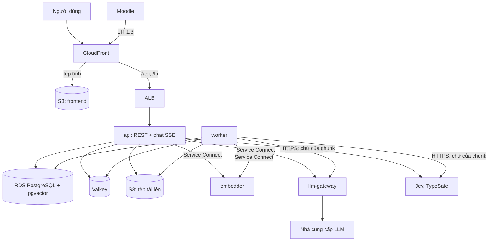

# Thiết kế hệ thống, bản v1

Trạng thái: chốt ngày 2026-11-05, dừng đo có trả phí theo quyết định của tác giả. Số đo trên một máy, chưa kiểm chứng trên AWS. Mọi số đo nằm ở
[`docs/measurements/2026-11-05-real-llm-and-jev.md`](../measurements/2026-11-05-real-llm-and-jev.md). Tài liệu này thay các phần tương ứng của
[`scalable-design.md`](scalable-design.md): thay reranker tự host bằng Jev, gộp chat vào `api`, và thêm kiểm soát tải LLM.

## Tóm tắt

Hệ thống là modular monolith chạy bốn service trên ECS Fargate: `api`, `worker`, `embedder`, `llm-gateway`. Dữ liệu nằm ở RDS, S3 và Valkey.

Kết quả chính: rerank trên CPU từng chặn cả sinh module và chat. Thay bằng Jev, 8 worker × 4 tăng từ 182,5 lên trung bình 504 modules/giờ, chat ở 4 API tăng từ 22,5 lên 462,3
tin nhắn/phút, chất lượng truy hồi ít nhất tương đương. Điều kiện còn mở: nhà trường phải đồng ý gửi tài liệu sang máy chủ ở Mỹ.

Chưa chứng minh được: ổn định dài hạn, chịu lỗi khi mất task, và mọi số trên AWS. Xem mục "Còn thiếu".

## Quyết định

| # | Quyết định | Chọn | Căn cứ | Không chọn | Trạng thái |
| --- | --- | --- | --- | --- | --- |
| 1 | Rerank | Jev `jev-1.14.0`, gọi riêng từng chunk, quay về thứ tự hybrid khi lỗi | Recall@8 0,992 bằng Jina, MRR@10 0,950 so với 0,929; p95 khi tải 1,4–2,7 s so với 123,5 s | Jina CPU: nghẽn. Không rerank: MRR 0,885, câu hỏi khác ngôn ngữ chỉ 0,787. Jina GPU: chưa đo, là phương án thay nếu trường không đồng ý | Đã chốt, chờ nhà trường |
| 2 | Model sinh module | Luna | 0 lỗi do tải ở 630 modules/giờ, hạn mức 2 triệu token/phút, khoảng 115.000 token/module | Haiku: trần khoảng 87 modules/giờ, khoảng 240.000 token/module. `gpt-oss-120b`: chỉ dùng để đo, chưa đánh giá chất lượng | Tạm chốt, cần judge |
| 3 | Kiểm soát tải LLM | L1: retry 429 từng lệnh gọi, tắt cooldown gateway | Cùng tải với 429 thật: L1 xong 30/32 module, L0 xong 1/32. Mỗi cấu hình chỉ chạy một lần | L0: một 429 kéo theo lỗi hàng loạt. L2: chưa đo, thêm phối hợp qua Valkey mà chưa có bằng chứng cần | Đã chốt, bằng chứng một lần chạy |
| 4 | Chat | SSE trong `api`, giới hạn stream riêng, không giữ kết nối DB khi chờ | 400 stream mở không lỗi. p95 từ đầu tiên 2,1–2,6 s với LLM giả 1,5 s, đến khi bão hòa. 2 API xử lý 8 tin/giây | Service `chat` riêng: chưa có số đo nào cần tách, thêm một service phải vận hành | Đã chốt, chưa đo TTFT trên model thật |
| 5 | Compute | ECS Fargate | Container không state, scale theo service | EC2 + Compose: tự vá máy, tự scale. EKS: thêm phí và vận hành | Chốt, chưa so thực tế |
| 6 | Hàng đợi | Bảng Postgres | Ở khoảng 630 modules/giờ, DB chỉ dùng khoảng 2–9% CPU. Job tạo cùng transaction với dữ liệu | SQS: cần outbox, trạng thái job vẫn ở Postgres | Chốt |
| 7 | Kiểu kiến trúc | Modular monolith, `api` và `worker` từ một image | API và worker scale ngang độc lập trên cùng một code | Microservices: không có nhóm cần deploy độc lập | Chốt |

## Kiến trúc

Vector nằm lại trong Postgres. Jev chỉ nhận câu hỏi và chữ của khoảng 30 chunk ứng viên từ hybrid search.

## Scale từng thành phần

| Thành phần | Scale | Tín hiệu | Khi quá tải | Bằng chứng |
| --- | --- | --- | --- | --- |
| `api` đọc | Ngang | Request mỗi target | 503 có `Retry-After` | 199, 372, 583 rps ở 1, 2, 4 task |
| `api` chat | Ngang | Số stream, CPU | 503 khi vượt `chat_max_streams` | Một API khoảng 5 tin/giây; 2 API đạt 8 tin/giây không xếp hàng |
| `worker` | Ngang | Job đang chờ | Job nằm trong hàng đợi | 319 và trung bình 504 modules/giờ ở 4 và 8 worker × 4, đợt ngắn |
| `embedder` | Ngang nếu cần | CPU, độ trễ | 429, client thử lại | Chưa thấy nghẽn trên GPU; **chưa đo trên CPU của Fargate** |
| `llm-gateway` | Ngang nếu cần | CPU | Xếp hàng theo quota | Dùng 2–19% CPU, chưa nghẽn |
| RDS, Valkey | Dọc | CPU, bộ nhớ | | Chưa chạm giới hạn |
| Jev, nhà cung cấp LLM | Không scale được, xin thêm hạn mức | 429 | Quay về hybrid; LLM thì xem dưới | 278 lệnh gọi/giây ở 64 đồng thời |

## Trần công suất

Công suất cuối cùng do quota bên ngoài quyết định, không phải số task.

| Trần | Giá trị | Nguồn |
| --- | --- | --- |
| Luna, sinh module | Khoảng 1.040 modules/giờ | Tính từ 2 triệu token/phút và khoảng 115.000 token/module |
| Haiku, sinh module | Khoảng 87 modules/giờ | Tính từ 80.000 token đầu ra/phút; khớp lần sập ở 2 worker |
| `gpt-oss-120b`, sinh module | Tính ra khoảng 138 modules/giờ, nhưng đo được 241,2 | Tính từ 250.000 token/phút và khoảng 109.000 token/module. Lần L1 dùng khoảng 407.000 token/phút trong 7,5 phút, chưa rõ vì sao vượt, nên các trần tính theo token/phút chưa được kiểm chứng |
| Jev, retrieval | Khoảng 9 retrieval/giây, 500 tin chat/phút | Đo: 278 lệnh gọi/giây, 30 lệnh mỗi retrieval |
| Jev từ 128 đồng thời | Tụt còn khoảng 60 lệnh gọi/giây | Đo từ một máy; chưa rõ do Jev hay máy đo |

Giới hạn `jev_max_concurrent = 64` hiện tính trên từng tiến trình. Nhiều task cộng lại có thể vượt 64 và rơi vào vùng tụt: 4 API ở 16 tin/giây chỉ xử lý được 252 tin/phút. Trên AWS phải đo lại. Nếu vùng tụt vẫn còn thì
dùng giới hạn chung qua Valkey hoặc chia hạn mức theo số task.

## Kiểm soát tải LLM

Vấn đề đã thấy với 429 thật: một 429 khóa model duy nhất 60 giây (`allowed_fails: 0`), các lệnh gọi sau nhận "No deployments available", job chạy lại từ đầu và tiêu lại token đã trả.

Đo trên Groq `gpt-oss-120b`, 32 module, 4 worker × 4:

| Cấu hình | Nội dung | Xong | Modules/giờ | Quyết định |
| --- | --- | --- | --- | --- |
| L0 | Trước đây | 1/32 | 17,6 | Bỏ |
| L1 | Retry 429 từng lệnh gọi, tắt cooldown gateway | 30/32 | 241,2 | **Chọn** |
| L2 | L1 cộng giới hạn slot LLM chung qua Valkey | Chưa đo | | Không dùng trong v1 |

Giới hạn của bằng chứng:

- Mỗi cấu hình chỉ chạy một lần, thay vì ba lần như kế hoạch, vì đã dừng đo có trả phí.
- Hai cấu hình không cùng điều kiện: Jev hết credit trong lần L1, 165/246 lần rerank phải quay về thứ tự hybrid. L0 không có lần nào, nhưng chỉ có 9 lần rerank.
- Hai module L1 lỗi do model viết sai mã trích dẫn, không phải do tải.
- Khoảng cách 1/32 và 30/32 đủ lớn để chọn L1. Con số 241,2 không phải công suất ổn định.

Chỉ job nền mới chờ khi gặp 429; request của người dùng vẫn báo lỗi ngay, để không giữ người dùng và kết nối DB trong nhiều phút. Ngoài ra: lỗi hết tiền không được retry mà báo ngay; câu trả lời bị nhà cung cấp từ chối vì sai schema được sinh lại ngay trong lệnh gọi đó.

Lần hết credit Jev cũng cho thấy job không lỗi khi Jev lỗi, nhưng chất lượng truy hồi giảm mà không có cảnh báo. Vì vậy mỗi lần quay về hybrid được ghi một dòng log `jev_fallback`, mức ERROR khi lỗi là 401, 402 hoặc 403. Cảnh báo CloudWatch từ dòng log này sẽ thêm cùng Terraform.

## Chat

1. Lưu câu hỏi, commit, đóng session. Không giữ kết nối DB trong lúc chờ.
2. Giới hạn 8 lượt tìm kiếm đồng thời trong mỗi tiến trình, thấp hơn pool kết nối.
3. Rerank tối đa 2 lần thử, lỗi thì giữ thứ tự hybrid.
4. Stream qua LLM không giữ thread, gửi `: ping` mỗi 15 s, ALB và CloudFront phải có timeout dài hơn mức này.
5. Sự kiện: `session`, `delta`, `done` hoặc `error`. Trích dẫn đọc từ mã `[S2]` trong câu trả lời và được bỏ khỏi văn bản.

## Chạy trên AWS

`api` và `worker` là hai task riêng, không chung đĩa, nên mọi thứ chúng trao cho nhau phải đi qua RDS hoặc S3.

| Biến | Giá trị trên AWS | Tác dụng |
| --- | --- | --- |
| `UPLOAD_STORE`, `UPLOAD_S3_BUCKET` | `s3`, tên bucket | API ghi tệp vào `uploads/<document id><đuôi>`, worker tải về thư mục tạm để đọc, xóa object sau khi embed. Xóa tài liệu hoặc môn học cũng xóa object. Thiếu bucket thì tiến trình không khởi động |
| `LOG_FORMAT` | `json` | Mỗi dòng log là một JSON có `time`, `level`, `logger`, `message`, kể cả log của uvicorn. `message` giữ nguyên chữ, nên metric filter `jev_fallback` chạy như cũ |
| `WORKER_SHUTDOWN_GRACE_SECONDS` | `100` trên `worker` | Thời gian job đang chạy được để xong khi task dừng, dưới `stopTimeout` 120 s của Fargate. Hết thời gian thì job được trả về hàng đợi |
| `QUEUE_METRICS` | `true` trên `worker` | Mỗi phút ghi một dòng EMF vào stdout: `JobsReady` (job đến hạn), `JobsRunning`, `OldestReadyJobAgeSeconds`, namespace `Microlearning/Jobs`. Job đang chờ backoff không tính vào `JobsReady`, vì worker mới cũng không lấy được nó. Chạy trong thread riêng, để vẫn báo khi mọi thread đang bận job dài |

Hai endpoint kiểm tra, cố ý khác nhau:

- `/health` cho health check của container: chỉ hỏi tiến trình còn chạy không. Lỗi thì ECS khởi động lại task.
- `/ready` cho target group của ALB: hỏi thêm RDS bằng một pool riêng một kết nối, timeout 2 s, để không phải xếp hàng sau request khi API bận. Không hỏi Valkey (rate limit có fallback trong bộ nhớ), gateway, embedder hay Jev: chúng dùng chung cho mọi task, nên một thành phần lỗi sẽ rút hết task khỏi ALB, kể cả cho request không cần nó.

Mỗi tiến trình worker đều báo cùng một số đếm, nên scaling và cảnh báo phải đọc `Maximum`, không đọc `Sum`.

Ba điểm chỉ lộ ra khi tách task hoặc chạy trên RDS, đã sửa:

- **Migration không chạy được trên RDS.** PostgreSQL 16 chỉ cho role có `BYPASSRLS` đổi thuộc tính này, kể cả sang `NOBYPASSRLS`, mà user master của RDS không phải superuser. Giả lập bằng một role có `CREATEROLE` nhưng không phải superuser: migration 0001 lỗi `permission denied to alter role`. Giờ worker được miễn RLS bằng policy `TO app_worker USING (true)` trên từng bảng (migration 0025), ở mọi môi trường, và không role ứng dụng nào còn `BYPASSRLS`. Quyền theo bảng của worker vẫn giữ nguyên. Một test bắt bảng RLS mới nào thiếu policy này.
- **`/ready` treo 87 s khi DB nhận kết nối mà không trả lời** (thử bằng cách pause container DB). `connect_timeout` và `statement_timeout` không cắt được trường hợp này. Giờ phép thử chạy trong thread có hạn chót 2 s, và không mở phép thử thứ hai khi phép thử trước còn treo.
- **Scale-in giết job đang chạy.** Job nằm ở `running` tới khi sweeper trả lại sau 15 phút, và token đã tiêu bị tiêu lại. Giờ worker có job thì bật scale-in protection của ECS, và khi bị dừng thì trả job chưa xong về hàng đợi ngay.

## Chi phí

Bỏ task reranker tiết kiệm $0,2465/giờ mỗi task. Jev khoảng $0,0007 mỗi retrieval, theo giá tài liệu của họ, nên hòa vốn ở khoảng 350 retrieval/giờ:

- **Demo và đồ án:** Jev rẻ hơn, vì tải thấp và chỉ trả tiền khi gọi. Nhiều giờ demo không dùng tới vẫn không tốn.
- **Tải cao và liên tục:** Jev đắt hơn trên mỗi retrieval. 500 tin chat/phút tốn khoảng $21/giờ. Khi đó nên cân nhắc reranker tự host nhưng phải đo lại, nhất là GPU.

Dự toán đồ án cũ khoảng $96, hoặc $115 với 20% dự phòng, sẽ giảm khi bỏ reranker và cộng thêm Jev, nhưng chưa được tính lại. LLM không nằm trong $200 credit AWS.

## Còn thiếu

| Việc | Lý do | Cần gì |
| --- | --- | --- |
| Nhà trường đồng ý gửi tài liệu sang Jev | Máy chủ ở Mỹ, không có thời hạn lưu cụ thể, được tạo telemetry từ dữ liệu | Bạn hỏi nhà trường |
| Ổn định 30 phút có hàng đợi | Lần 96 module dừng ở 5,5 phút vì hết credit | Không đo trong đợt này, cần credit LLM và Jev |
| Lặp lại L0, L1 và đo L2 | Mỗi cấu hình chạy tối đa một lần | Không đo trong đợt này, cần credit Jev và Groq |
| TTFT trên model thật khi có tải và có Jev | Mới đo một người dùng với Jina: 3,4–7,3 s | Không đo trong đợt này, cần credit Jev và Groq |
| Judge module chọn ngữ cảnh bằng Jev so với Jina | Mới đo retrieval, chưa đo đầu ra | LLM chất lượng cao hơn và model judge |
| Câu hỏi thật của sinh viên | Bộ hiện tại do LLM viết, có thể có lợi cho Jev | Người dùng thật |
| Chịu lỗi: dừng từng loại task | Chưa đo | Chạy được trên máy này |
| Embedder trên CPU Fargate | Mọi số đo dùng GPU | Đo trên AWS |
| Mọi số trên AWS | Máy đo dùng chung 7,57 GiB RAM | Terraform, chạy đo |
| Code chưa có | Giới hạn Jev chung; LTI cho sinh viên, Deep Linking, trả điểm | Viết code; sinh viên cần thêm thành viên khóa học vào RLS |
| Terraform chưa `apply` lần nào | `infra/terraform` mới qua `validate` và `terraform test` với AWS giả lập | Tài khoản AWS, chạy theo `infra/README.md` |
| Bật Jev trong production | Code mặc định vẫn dùng Jina, chỉ gửi sang TypeSafe khi đặt `RERANKER_PROVIDER=jev`, để không gửi tài liệu khi trường chưa đồng ý | Nhà trường đồng ý |
| Credit Jev | Tài khoản TypeSafe đang trả 402; khi chưa nạp, hệ thống chỉ chạy với thứ tự hybrid | Nạp trước khi demo |
| Điều kiện chứng minh | Ngưỡng ở `scalable-design.md` mục 3 là đề xuất | Giảng viên đồng ý |
