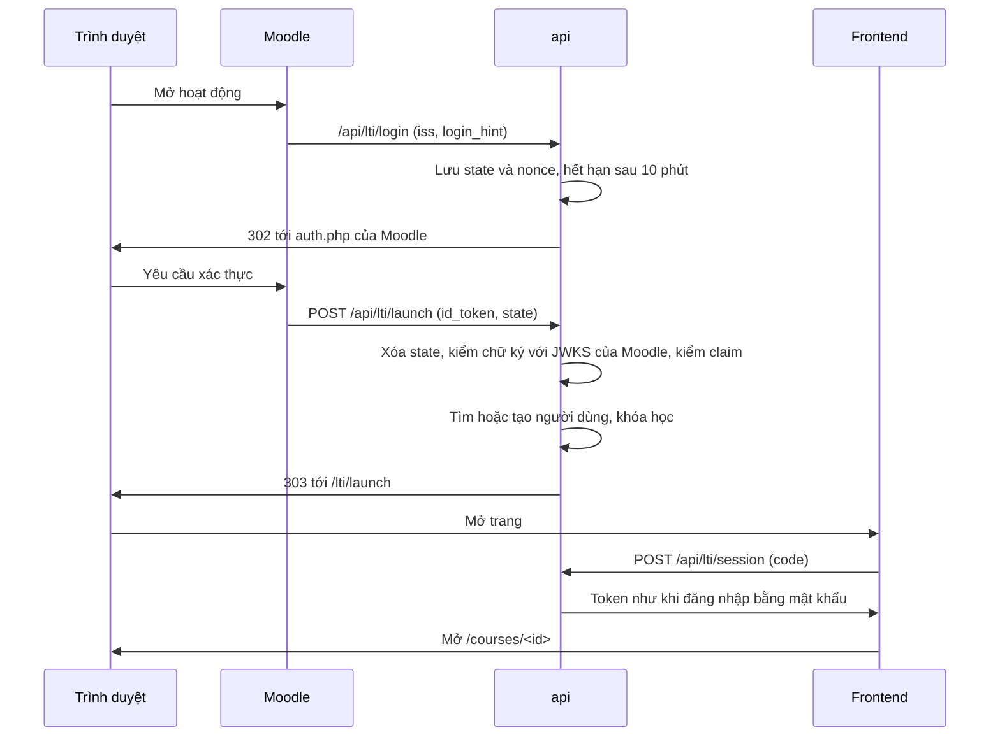

# LTI 1.3: mở công cụ từ Moodle

Giảng viên bấm vào một hoạt động External tool trong khóa học Moodle. Công cụ đăng nhập họ, không cần mật khẩu, và mở đúng khóa học tương ứng ở đây. Plugin `local_lms_bridge` vẫn giữ việc xuất Book và Quiz sang Moodle.

Phạm vi bản này: launch cho giảng viên và sinh viên. Giảng viên dùng đủ công cụ; sinh viên chỉ chat với tài liệu của khóa (xem [Sinh viên](#sinh-viên)). Chưa có Deep Linking, trả điểm và danh sách lớp (xem [Giới hạn](#giới-hạn)).

## Cài đặt

`PUBLIC_URL` là địa chỉ người dùng mở ứng dụng. Trên AWS là output `url` của Terraform; trên compose là `https://localhost:8443`.

### 1. Trong Moodle

*Quản trị trang → Plugin → Mô-đun hoạt động → External tool → Quản lý công cụ → Cấu hình công cụ thủ công*:

| Trường | Giá trị |
| --- | --- |
| Phiên bản LTI | LTI 1.3 |
| Tool URL | `{PUBLIC_URL}/api/lti/launch` |
| Loại khóa công khai | Keyset URL |
| Public keyset | `{PUBLIC_URL}/api/lti/jwks` |
| Initiate login URL | `{PUBLIC_URL}/api/lti/login` |
| Redirection URI(s) | `{PUBLIC_URL}/api/lti/launch` |
| Chia sẻ tên người dùng | Luôn luôn |
| Chia sẻ email người dùng | Luôn luôn (không bắt buộc) |
| Vùng chứa mặc định khi mở | **Cửa sổ mới** |

Redirection URI phải khớp từng ký tự với `{PUBLIC_URL}/api/lti/launch`. Sau khi lưu, bấm biểu tượng *Xem chi tiết cấu hình* của công cụ để lấy Platform ID, Client ID, Deployment ID và các URL dùng ở bước 2.

**Vì sao mở cửa sổ mới:** khi chạy trong iframe, trình duyệt tách riêng bộ nhớ của trang con theo trang cha, nên phiên đăng nhập trong iframe không dùng chung với tab mở trực tiếp. Launch vẫn chạy được trong iframe, vì nó không dựa vào cookie.

### 2. Trong công cụ

Chạy bằng URL chủ của database (`DATABASE_URL`), vì role phục vụ request chỉ được đọc bảng platform:

```bash
PYTHONPATH=. python scripts/register_lti_platform.py \
  --issuer "<Platform ID>" \
  --client-id "<Client ID>" \
  --auth-login-url "<Authentication request URL>" \
  --jwks-url "<Public keyset URL>" \
  --deployment "<Deployment ID>" \
  --links-moodle
```

Chỉ thêm `--links-moodle` cho Moodle của dự án, tức Moodle mà plugin cũng nối tới. Khi có cờ này, launch xác nhận luôn mã người dùng và mã khóa học Moodle (xem dưới). Chạy lại lệnh với cùng issuer và client id thì URL được cập nhật và deployment được thêm.

- **Compose:** `docker compose run --rm -e PYTHONPATH=. migrate uv run python scripts/register_lti_platform.py ...`
- **AWS:** chạy task migrate với lệnh khác:

```bash
aws ecs run-task --cluster <cluster> --launch-type FARGATE \
  --task-definition microlearning-demo-migrate \
  --network-configuration "awsvpcConfiguration={subnets=[...],securityGroups=[...],assignPublicIp=ENABLED}" \
  --overrides '{"containerOverrides":[{"name":"migrate","environment":[{"name":"PYTHONPATH","value":"/app"}],"command":["/app/.venv/bin/python","scripts/register_lti_platform.py","--issuer","...","--client-id","...","--auth-login-url","...","--jwks-url","...","--deployment","..."]}]}'
```

Subnet và security group lấy từ output `migrate`.

## Luồng



Kiểm tra trên id_token:

- Chữ ký RS256 với khóa trong JWKS của platform. Bộ khóa được cache; khi gặp key id lạ thì tải lại, để bắt kịp lúc platform đổi khóa.
- `iss`, `aud` đúng đăng ký. Nếu có nhiều `aud` thì `azp` phải là công cụ này.
- `exp`, `iat`, cho lệch đồng hồ 60 s.
- `nonce` khớp lần đăng nhập. State dùng được một lần, kể cả khi launch bị từ chối.
- `deployment_id` đã đăng ký, `version` là `1.3.0`, `message_type` là `LtiResourceLinkRequest`, và có `context`.

## Người dùng và khóa học

- **Người dùng** được nhận diện bằng `(platform, sub)`. Theo chuẩn, `sub` là duy nhất trong một platform, nên khóa không cần thêm deployment. Email không dùng để nhận diện: launch không chứng minh người đó sở hữu địa chỉ ở đây. Nếu email đã có tài khoản thì người dùng LTI nhận địa chỉ `lti-…@lti.invalid` và mật khẩu ngẫu nhiên, tức chỉ vào được qua LMS.
- **Khóa học** được nhận diện bằng `(platform, deployment, context id)`. Lần đầu mở thì tạo khóa học mang tên khóa trong LMS, thuộc giảng viên đã mở.
- **Với `--links-moodle`:** `sub` là mã người dùng Moodle và context id là mã khóa học Moodle, cả hai đều do chữ ký của Moodle bảo đảm.
  - Tài khoản đã liên kết Moodle qua plugin với cùng mã người dùng được dùng luôn, nên không có tài khoản thứ hai.
  - Khóa học của giảng viên đó đã nối với cùng mã khóa học Moodle cũng được dùng luôn.
  - Người dùng mới nhận `moodle_user_id`, khóa học mới nhận `moodle_course_id`, nên xuất bản sang Moodle và hạn mức sinh đầy đủ hoạt động như tài khoản đã liên kết.

## Sinh viên

- **Vào khóa nào:** launch với vai trò `Learner` mở khóa học mà giảng viên đã gắn với cùng `(platform, deployment, context id)`, và thêm sinh viên vào `course_members`. Nếu chưa giảng viên nào mở công cụ trong khóa LMS đó thì từ chối: chưa có gì để chat.
- **Được làm gì:** chỉ chat với tài liệu của khóa (`/courses/{id}/chat`, `/chat/stream`, `/chat/latest`, `/chat/{session}/history`). Frontend đưa sinh viên tới `/learn/{course}`, không có danh sách khóa, tài liệu hay module.
- **Tầng DB (migration 0027):** thành viên chỉ được SELECT khóa học, `documents` và `chunks`. Mọi thao tác ghi trên khóa và các bảng con vẫn đòi là chủ. Module, câu hỏi, job và đánh giá chỉ chủ thấy. Phiên chat thuộc về người đã chat: giảng viên không đọc chat của sinh viên, sinh viên không đọc chat của nhau.
- **Tài khoản:** tài khoản mà launch `Learner` tạo ra có `can_author = false`, nên không tạo được khóa học. Launch `Instructor` sau đó bật lại quyền này. Nếu người đó đã là thành viên của chính khóa ấy thì vẫn bị từ chối như giảng viên thứ hai.
- **Hạn mức:** `LEARNER_DAILY_CHAT_LIMIT` (mặc định 30) tin mỗi ngày cho mỗi tài khoản sinh viên, vì mỗi tin là một lần gọi model trả tiền. Giảng viên không bị tính.

## Kiểm chứng

- **Với Moodle thật:** `devops/lti-e2e/run.sh` dựng Moodle 5.2.3 của repo, cấu hình giảng viên, sinh viên, khóa học và công cụ LTI 1.3 như trong trang quản trị, rồi đi trọn luồng launch như một trình duyệt. Kết quả lần chạy 2026-11-06, sau migration 0027:
  - Sinh viên mở trước khi giảng viên mở công cụ: bị từ chối (400).
  - Giảng viên vào được và thấy khóa học; lần mở thứ hai dùng lại đúng tài khoản và khóa học.
  - Sinh viên mở sau đó: vào đúng khóa học của giảng viên với `can_author = false`, danh sách khóa rỗng, chat trả 200, danh sách tài liệu trả 404. DB có đúng 1 dòng `course_members`.
  - `moodle_user_id` và `moodle_course_id` khớp id trong Moodle.

  Stack này tách riêng: DB trên tmpfs, mã nguồn Moodle mount chỉ đọc, không tạo volume, không đụng `do-an_db_data` hay `moodle/config.php`, và tự xóa khi xong. Cần khoảng 1 GB RAM và vài phút để Moodle cài đặt.
- **Các trường hợp lỗi:** `backend/tests/integration/test_lti_launch.py` dùng một LMS giả ký bằng khóa RSA thật: sai chữ ký, sai audience, hết hạn, sai nonce, deployment lạ, phát lại state, dùng lại mã, và luồng sinh viên (vào trước giảng viên, chỉ chat được, hạn mức, đổi vai trò).
- **Quyền ở tầng DB:** `backend/tests/integration/test_course_membership_rls.py` chạy SQL trực tiếp bằng role của request: thành viên đọc được gì, không sửa hay thêm được gì, và ai thấy chat của ai.
- **Chưa thử trên trình duyệt thật.** Script đóng vai trình duyệt nên dừng ở bước đổi mã; trang `/lti/launch` của frontend chỉ có test unit.

## Giới hạn

- **Sinh viên không thấy module đã xuất bản trong công cụ.** Họ đọc Book và Quiz trên Moodle như trước.
- **Không rút thành viên khi LMS rút tên.** Sinh viên bị gỡ khỏi khóa Moodle không launch được nữa, nhưng nếu còn token thì vẫn chat được tới khi token hết hạn (14 ngày). Names and Role Provisioning sẽ đồng bộ được việc này.
- **Mỗi khóa học thuộc một giảng viên.** Giảng viên thứ hai mở cùng khóa LMS sẽ nhận thông báo khóa đã thuộc người khác.
- **State không gắn với trình duyệt.** Không có cookie, nên kẻ tấn công có thể khiến nạn nhân đăng nhập vào tài khoản LTI của chính kẻ tấn công (login CSRF). Họ không lấy được gì của nạn nhân, nhưng nạn nhân có thể vô tình tải tài liệu vào khóa học của kẻ tấn công. Gắn state với cookie `SameSite=None` khi mở cửa sổ mới sẽ chặn được.

