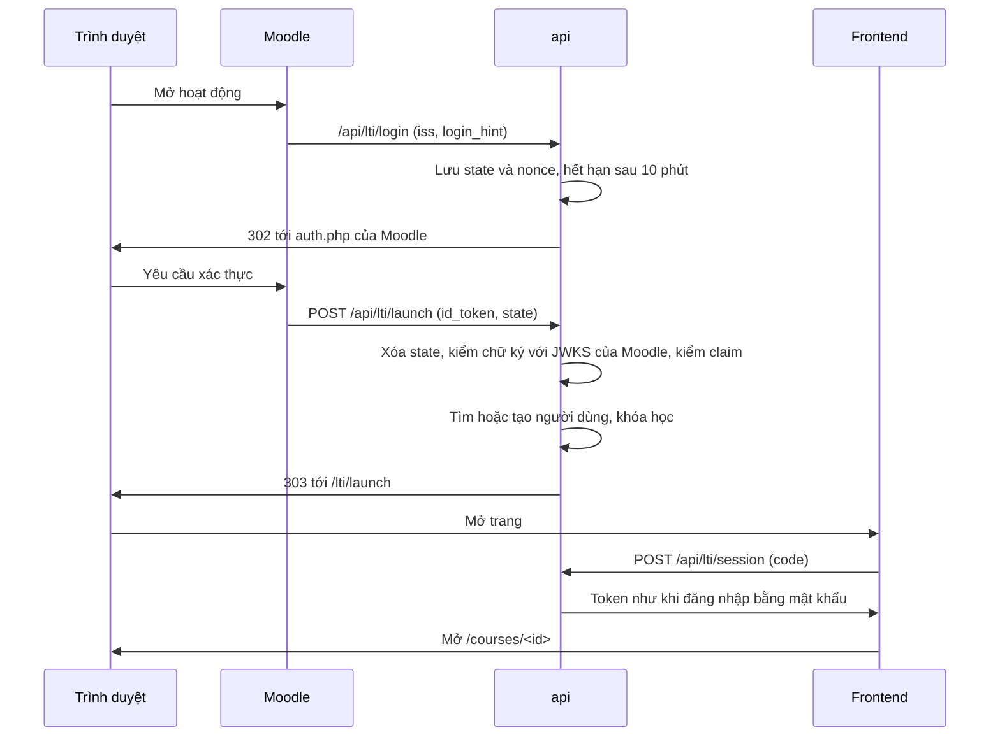

# LTI 1.3: mở công cụ từ Moodle

Giảng viên bấm vào một hoạt động External tool trong khóa học Moodle. Công cụ đăng nhập họ, không cần mật khẩu, và mở đúng khóa học tương ứng ở đây. Plugin `local_lms_bridge` vẫn giữ việc xuất Book và Quiz sang Moodle.

Phạm vi bản này: chỉ launch và vai trò giảng viên. Chưa có Deep Linking, trả điểm, danh sách lớp, và sinh viên chưa vào được (xem [Giới hạn](#giới-hạn)).

## Cài đặt

`PUBLIC_URL` là địa chỉ người dùng mở ứng dụng. Trên AWS là output `url` của Terraform; trên compose là `https://localhost:8443`.

### 1. Trong Moodle

*Quản trị trang → Plugin → Mô-đun hoạt động → External tool → Quản lý công cụ → Cấu hình công cụ thủ công*:

| Trường | Giá trị |
| --- | --- |
| Phiên bản LTI | LTI 1.3 |
| Tool URL | `{PUBLIC_URL}/api/lti/launch` |
| Loại khóa công khai | Keyset URL |
| Public keyset | `{PUBLIC_URL}/api/lti/jwks` |
| Initiate login URL | `{PUBLIC_URL}/api/lti/login` |
| Redirection URI(s) | `{PUBLIC_URL}/api/lti/launch` |
| Chia sẻ tên người dùng | Luôn luôn |
| Chia sẻ email người dùng | Luôn luôn (không bắt buộc) |
| Vùng chứa mặc định khi mở | **Cửa sổ mới** |

Redirection URI phải khớp từng ký tự với `{PUBLIC_URL}/api/lti/launch`. Sau khi lưu, bấm biểu tượng *Xem chi tiết cấu hình* của công cụ để lấy Platform ID, Client ID, Deployment ID và các URL dùng ở bước 2.

**Vì sao mở cửa sổ mới:** khi chạy trong iframe, trình duyệt tách riêng bộ nhớ của trang con theo trang cha, nên phiên đăng nhập trong iframe không dùng chung với tab mở trực tiếp. Launch vẫn chạy được trong iframe, vì nó không dựa vào cookie.

### 2. Trong công cụ

Chạy bằng URL chủ của database (`DATABASE_URL`), vì role phục vụ request chỉ được đọc bảng platform:

```bash
PYTHONPATH=. python scripts/register_lti_platform.py \
  --issuer "<Platform ID>" \
  --client-id "<Client ID>" \
  --auth-login-url "<Authentication request URL>" \
  --jwks-url "<Public keyset URL>" \
  --deployment "<Deployment ID>" \
  --links-moodle
```

Chỉ thêm `--links-moodle` cho Moodle của dự án, tức Moodle mà plugin cũng nối tới. Khi có cờ này, launch xác nhận luôn mã người dùng và mã khóa học Moodle (xem dưới). Chạy lại lệnh với cùng issuer và client id thì URL được cập nhật và deployment được thêm.

- **Compose:** `docker compose run --rm -e PYTHONPATH=. migrate uv run python scripts/register_lti_platform.py ...`
- **AWS:** chạy task migrate với lệnh khác:

```bash
aws ecs run-task --cluster <cluster> --launch-type FARGATE \
  --task-definition microlearning-demo-migrate \
  --network-configuration "awsvpcConfiguration={subnets=[...],securityGroups=[...],assignPublicIp=ENABLED}" \
  --overrides '{"containerOverrides":[{"name":"migrate","environment":[{"name":"PYTHONPATH","value":"/app"}],"command":["/app/.venv/bin/python","scripts/register_lti_platform.py","--issuer","...","--client-id","...","--auth-login-url","...","--jwks-url","...","--deployment","..."]}]}'
```

Subnet và security group lấy từ output `migrate`.

## Luồng



Kiểm tra trên id_token:

- Chữ ký RS256 với khóa trong JWKS của platform. Bộ khóa được cache; khi gặp key id lạ thì tải lại, để bắt kịp lúc platform đổi khóa.
- `iss`, `aud` đúng đăng ký. Nếu có nhiều `aud` thì `azp` phải là công cụ này.
- `exp`, `iat`, cho lệch đồng hồ 60 s.
- `nonce` khớp lần đăng nhập. State dùng được một lần, kể cả khi launch bị từ chối.
- `deployment_id` đã đăng ký, `version` là `1.3.0`, `message_type` là `LtiResourceLinkRequest`, và có `context`.

## Người dùng và khóa học

- **Người dùng** được nhận diện bằng `(platform, sub)`. Theo chuẩn, `sub` là duy nhất trong một platform, nên khóa không cần thêm deployment. Email không dùng để nhận diện: launch không chứng minh người đó sở hữu địa chỉ ở đây. Nếu email đã có tài khoản thì người dùng LTI nhận địa chỉ `lti-…@lti.invalid` và mật khẩu ngẫu nhiên, tức chỉ vào được qua LMS.
- **Khóa học** được nhận diện bằng `(platform, deployment, context id)`. Lần đầu mở thì tạo khóa học mang tên khóa trong LMS, thuộc giảng viên đã mở.
- **Với `--links-moodle`:** `sub` là mã người dùng Moodle và context id là mã khóa học Moodle, cả hai đều do chữ ký của Moodle bảo đảm.
  - Tài khoản đã liên kết Moodle qua plugin với cùng mã người dùng được dùng luôn, nên không có tài khoản thứ hai.
  - Khóa học của giảng viên đó đã nối với cùng mã khóa học Moodle cũng được dùng luôn.
  - Người dùng mới nhận `moodle_user_id`, khóa học mới nhận `moodle_course_id`, nên xuất bản sang Moodle và hạn mức sinh đầy đủ hoạt động như tài khoản đã liên kết.

## Giới hạn

- **Sinh viên bị từ chối.** RLS hiện lọc theo chủ khóa học. Cho sinh viên vào phải thêm quan hệ thành viên khóa học vào RLS, là một thay đổi bảo mật cần test riêng.
- **Mỗi khóa học thuộc một giảng viên.** Giảng viên thứ hai mở cùng khóa LMS sẽ nhận thông báo khóa đã thuộc người khác.
- **State không gắn với trình duyệt.** Không có cookie, nên kẻ tấn công có thể khiến nạn nhân đăng nhập vào tài khoản LTI của chính kẻ tấn công (login CSRF). Họ không lấy được gì của nạn nhân, nhưng nạn nhân có thể vô tình tải tài liệu vào khóa học của kẻ tấn công. Gắn state với cookie `SameSite=None` khi mở cửa sổ mới sẽ chặn được.
- **Chưa thử với Moodle thật.** Đã test bằng một LMS giả ký bằng khóa RSA thật (`backend/tests/integration/test_lti_launch.py`), nhưng chưa chạy với Moodle 5.2 của dự án.
